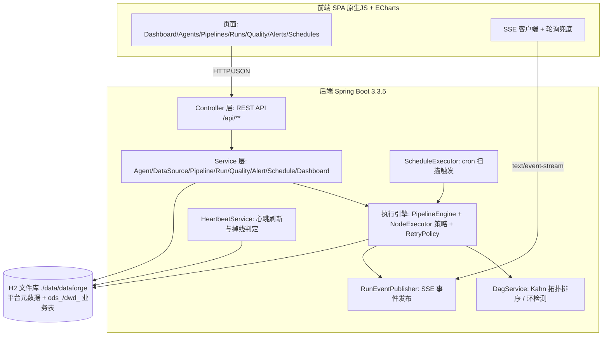

# 多 Agent ETL / 数据管道编排平台

平台将 ETL 中的抽取(Extract)、转换(Transform)、加载(Load)、质量检查(Quality Check)、编排(Orchestration)五类角色抽象为五类自治 Agent,通过可视化 DAG 编辑器编排数据管道,由执行引擎按拓扑层级并行调度节点执行,并提供运行监控、实时日志推送(SSE)、心跳注册、数据质量检查、告警与定时调度等完整能力。

首次启动自动生成完整演示数据(Agent、数据源、管道、30 天历史运行记录、质量规则、告警、调度任务),开箱即可体验全流程。

## 亮点

- **多 Agent 架构**:五类 Agent(EXTRACTOR / TRANSFORMER / LOADER / QUALITY_CHECKER / ORCHESTRATOR)各司其职,具备心跳注册、状态管理、并发负载指标
- **可视化 DAG 编排**:前端 Canvas/SVG 拖拽编辑器,支持拓扑校验(Kahn 算法 + 环检测)、按层并行执行
- **执行引擎**:线程池并行调度、节点级重试、FAIL_FAST / CONTINUE 两种失败策略、取消支持、真实行数流转
- **实时监控**:SSE 推送运行事件与日志,前端实时时间线与日志终端,降级轮询兜底
- **数据质量**:六类检查规则(NULL / RANGE / UNIQUE / REGEX / ENUM / ROW_COUNT),对 H2 源表真实执行
- **零依赖演示**:H2 文件库持久化,内置 1 万用户 / 5 万订单 / 10 万事件模拟业务源表

## 功能清单(按模块)

| 模块 | 功能 |
|---|---|
| 总览 Dashboard | 统计卡片、14 天运行趋势折线、运行状态分布饼图、Agent 负载柱图、管道排行 TOP5、最近运行、质量通过率仪表,15s 自动刷新 |
| Agent 管理 | Agent CRUD、启动 / 停止 / 重启、能力标签、心跳时间与在线状态、执行指标(总数 / 成功率 / 平均耗时 / 当前并发) |
| 数据源管理 | 数据源 CRUD(MYSQL / H2 / CSV / REST_API / KAFKA / HDFS_SIM)、连通性测试(返回延迟)、表清单查看 |
| 管道编排 | 管道 CRUD、DAG 可视化编辑(节点拖拽 / 连线 / 配置表单)、拓扑校验、启用 / 禁用、手动触发 |
| 运行监控 | 运行列表(状态 / 管道筛选 + 分页)、运行详情(节点时间线 / 行数统计)、实时日志(SSE,2s 轮询兜底)、取消 / 重跑 |
| 数据质量 | 质量规则 CRUD、检查结果列表(期望值 / 实际值 / 通过率徽标) |
| 告警中心 | 告警列表(级别筛选)、已读 / 未读、全部已读、删除 |
| 定时调度 | 调度任务 CRUD、六位 cron 表达式(秒 分 时 日 月 周)、上次 / 下次触发时间、启用开关 |
| AI 智能层 | 智能问答(11 种意图识别 + 槽位补全多轮追问)、混合检索 RAG(TF-IDF + n-gram 向量,强制引用 / 不足拒答)、失败运行智能诊断、自然语言生成管道 DAG(自动拓扑校验落草稿)、检索调试与意图面板、幻觉治理(数字溯源 + guardNotes 审计),真实 LLM / 内置模拟双模式 |
| Agent 消息总线 | 节点交接 DATA_HANDOFF(有向,带行数血缘)+ DATA_READY 完成广播,消息落库 + SSE 实时推送,运行详情通信面板可视,启动自动回填历史消息,窄接口可平滑演进 Kafka |

## 技术栈

| 层次 | 技术 | 版本 |
|---|---|---|
| 语言 | Java | 17 |
| 框架 | Spring Boot(Web / Data JPA / Validation) | 3.3.5 |
| 数据库 | H2(文件库,MySQL 兼容模式,`AUTO_SERVER=TRUE`) | 随 Spring Boot 管理 |
| API 文档 | springdoc-openapi(Swagger UI) | 2.6.0 |
| CSV 支持 | Apache Commons CSV | 1.11.0 |
| 前端 | 原生 JavaScript SPA(hash 路由)+ ECharts(本地 vendor 引用) | — |
| LLM 集成 | OpenAI 兼容协议(RestTemplate),默认 Kimi,可切 DeepSeek / OpenAI;未配置 API Key 自动进入内置模拟模式,AI 功能照常可演示 | — |
| 构建 | Maven(打包产物 `agent-etl-platform.jar`) | — |

## 架构图



## 环境要求

- **JDK 17**(必需;Spring Boot 3.x 最低要求 Java 17)
- Maven 3.6+(或使用 IDEA 内置 Maven)
- 项目仓库内配置了阿里云 Maven 镜像加速,海外环境可删除 `pom.xml` 中的 `repositories` 段

## IDEA 打开与运行(详细步骤)

1. **确认 JDK 17**:打开 `File → Project Structure → Project`,SDK 选择 17;如无则 `Download JDK` 下载一个 17 版本(如 Temurin / Microsoft OpenJDK 17)。
2. **打开项目**:`File → Open`,选择 `pom.xml` 所在目录(即项目根目录 `agent-etl-platform`),在弹窗中选择 **Open as Project**(或直接信任 Maven 项目)。
3. **等待 Maven 索引与依赖下载**:右下角进度条走完;若依赖未自动下载,打开右侧 **Maven 面板**,点击刷新按钮(Reload All Maven Projects)。
4. **运行方式一(推荐)**:打开 `src/main/java/com/dataforge/etl/DataForgeApplication.java`,点击 `main` 方法旁的绿色三角,选择 **Run 'DataForgeApplication'**。
5. **运行方式二(Maven)**:右侧 Maven 面板 → `agent-etl-platform → Plugins → spring-boot → spring-boot:run`,双击运行。
6. **验证启动成功**:控制台出现 `Started DataForgeApplication` 与端口 8080 日志;浏览器访问 http://localhost:8080 。

> 启动配置无需额外 VM 参数;如需指定内存,见 `docs/DEPLOYMENT.md`。

## 访问地址

| 入口 | 地址 | 说明 |
|---|---|---|
| 前端界面 | http://localhost:8080 | 深色科技风 SPA,hash 路由 |
| AI 助手页 | http://localhost:8080/#/ai | 智能问答 / 失败诊断 / 生成管道 / 检索调试 / 意图面板(mock 模式顶部有横幅) |
| Swagger UI | http://localhost:8080/swagger-ui.html | 在线 API 文档与调试 |
| OpenAPI JSON | http://localhost:8080/v3/api-docs | OpenAPI 3 描述 |
| H2 控制台 | http://localhost:8080/h2-console | 数据库 Web 控制台 |

**H2 控制台连接参数**:

| 字段 | 值 |
|---|---|
| Driver Class | `org.h2.Driver` |
| JDBC URL | `jdbc:h2:file:./data/dataforge;AUTO_SERVER=TRUE;MODE=MySQL;DATABASE_TO_LOWER=TRUE` |
| User Name | `sa` |
| Password | (空) |

## 首次启动的演示数据

`dataforge.seed.enabled=true`(默认)且数据库为空时,`DataInitializer` 自动生成:

- **10 个 Agent**:覆盖全部五类 AgentType,含能力标签与历史指标
- **8 个数据源**:覆盖 MYSQL / H2 / CSV / REST_API / KAFKA / HDFS_SIM 类型
- **6 条管道**:含完整 DAG(节点 + 边),部分已启用
- **30 天历史运行记录 ≥ 800 条**:含节点运行明细(NodeRun)与运行日志(RunLog),状态分布覆盖 SUCCESS / FAILED / PARTIAL_SUCCESS 等
- **8 条质量规则 + 检查结果**
- **30 条告警**、**5 个调度任务**
- **业务模拟源表**:`ods_users`(1 万行)/ `ods_orders`(5 万行)/ `ods_events`(10 万行),由 `MockDataGenerator` 用 JdbcTemplate 批量写入,供 EXTRACTOR 真实 count、QUALITY_CHECKER 真实检查

删除 `./data` 目录后重启即可重新生成。

## 配置真实 LLM(AI 智能层)

AI 智能层内置**模拟模式**:未配置 API Key 时,意图识别、RAG 问答、失败诊断、生成管道全部功能照常可演示(响应带 `mockMode: true`,前端 `#/ai` 页顶部显示 mock 横幅)。接入真实模型只需设置环境变量并重启:

```bash
# Windows(PowerShell)
$env:DATAFORGE_LLM_API_KEY="sk-xxxx"
# Windows(CMD)
set DATAFORGE_LLM_API_KEY=sk-xxxx
# Linux / macOS
export DATAFORGE_LLM_API_KEY=sk-xxxx
```

切换服务商只需修改 `application.yml` 的 `dataforge.llm.base-url` 与 `dataforge.llm.model`,代码零改动(OpenAI 兼容协议):

| 服务商 | base-url | 推荐 model |
|---|---|---|
| Kimi(默认) | `https://api.moonshot.cn/v1` | `moonshot-v1-8k` |
| DeepSeek | `https://api.deepseek.com/v1` | `deepseek-chat` |
| OpenAI | `https://api.openai.com/v1` | `gpt-4o-mini` |

详细配置与安全说明见 [docs/AI.md](docs/AI.md)。

## 命令行打包与运行

```bash
# 打包(跳过测试)
mvn -DskipTests package

# 运行
java -jar target/agent-etl-platform.jar
```

更多 JVM 参数、生产调优与切换 MySQL 见 [docs/DEPLOYMENT.md](docs/DEPLOYMENT.md)。

## 目录结构

```
agent-etl-platform/
├── pom.xml                          # Maven 配置(Java 17 / Spring Boot 3.3.5)
├── AGENT_SPEC.md                    # 并行开发共享契约
├── README.md                        # 本文件
├── docs/
│   ├── ARCHITECTURE.md              # 架构设计详解
│   ├── API.md                       # REST API 参考
│   ├── INTERVIEW.md                 # Agent 与后端面试要点
│   └── DEPLOYMENT.md                # 部署与运维指南
├── src/main/java/com/dataforge/etl/
│   ├── DataForgeApplication.java    # 启动类
│   ├── common/                      # ApiResponse / PageResult / BizException / GlobalExceptionHandler
│   ├── config/                      # EngineThreadPoolConfig / WebConfig / OpenApiConfig
│   ├── agent/                       # Agent 实体、心跳与指标服务、Controller
│   ├── datasource/                  # 数据源实体、模拟测试与表清单、Controller
│   ├── pipeline/                    # Pipeline/PipelineNode/PipelineEdge、DagService、Controller
│   ├── engine/                      # PipelineEngine、NodeExecutor 策略、RunEventPublisher(SSE)、RetryPolicy
│   ├── run/                         # PipelineRun/NodeRun/RunLog、RunService、Controller
│   ├── quality/                     # QualityRule/QualityResult、真实质量检查、Controller
│   ├── alert/                       # Alert 实体与告警服务、Controller
│   ├── schedule/                    # ScheduleJob、CronParser、ScheduleExecutor、Controller
│   ├── dashboard/                   # Dashboard 聚合服务与 Controller
│   ├── meta/                        # 枚举元数据 Controller
│   └── seed/                        # MockDataGenerator + DataInitializer
├── src/main/resources/
│   ├── application.yml              # 端口/数据源/引擎/心跳/种子/模拟配置
│   └── static/                      # 前端 SPA(index.html、css/、js/、vendor/echarts.min.js)
└── src/test/java/                   # DagServiceTest / CronParserTest 等
```

## API 一览(Base: `/api`,统一响应 `{"code":0,"message":"ok","data":...}`)

| 模块 | 方法 + 路径 | 说明 |
|---|---|---|
| Dashboard | `GET /api/dashboard/overview` | 总览统计 |
| Dashboard | `GET /api/dashboard/run-trend?days=14` | N 天运行趋势 |
| Dashboard | `GET /api/dashboard/status-distribution` | 运行状态分布 |
| Dashboard | `GET /api/dashboard/agent-load` | Agent 负载 |
| Dashboard | `GET /api/dashboard/pipeline-rank?limit=5` | 管道排行 |
| Dashboard | `GET /api/dashboard/recent-runs?limit=10` | 最近运行 |
| Dashboard | `GET /api/dashboard/quality-summary` | 质量通过率汇总 |
| Agents | `GET/POST /api/agents`、`GET/PUT/DELETE /api/agents/{id}` | Agent CRUD |
| Agents | `POST /api/agents/{id}/start` `/stop` `/restart` | 状态流转 |
| DataSources | `GET/POST /api/datasources`、`GET/PUT/DELETE /{id}` | 数据源 CRUD |
| DataSources | `POST /api/datasources/{id}/test` | 连通性测试 |
| DataSources | `GET /api/datasources/{id}/tables` | 表清单 |
| Pipelines | `GET/POST /api/pipelines`、`GET/PUT/DELETE /{id}` | 管道 CRUD(DAG 整体替换) |
| Pipelines | `POST /api/pipelines/{id}/enable` `/disable` | 启用 / 禁用 |
| Pipelines | `POST /api/pipelines/{id}/validate` | 拓扑校验 + 环检测 |
| Pipelines | `POST /api/pipelines/{id}/trigger` | 异步触发,返回 `{runId}` |
| Runs | `GET /api/runs?status=&pipelineId=&page=&size=` | 分页查询 |
| Runs | `GET /api/runs/{id}` | 详情含 nodeRuns |
| Runs | `GET /api/runs/{id}/logs?nodeRunId=` | 运行日志 |
| Runs | `POST /api/runs/{id}/cancel` `/rerun` | 取消 / 重跑 |
| Runs | `GET /api/runs/stream` | SSE 实时事件流 |
| Quality | `GET/POST /api/quality/rules`、`PUT/DELETE /{id}` | 规则 CRUD |
| Quality | `GET /api/quality/results?ruleId=&page=&size=` | 检查结果分页 |
| Alerts | `GET /api/alerts?read=&page=&size=` | 告警分页 |
| Alerts | `POST /api/alerts/{id}/read`、`/read-all`、`DELETE /{id}` | 已读 / 删除 |
| Schedules | `GET/POST /api/schedules`、`GET/PUT/DELETE /{id}` | 调度 CRUD |
| Schedules | `POST /api/schedules/{id}/enable` `/disable` | 启用 / 禁用 |
| Meta | `GET /api/meta/enums` | 全量枚举 |
| Messages | `GET /api/messages?runId=&page=&size=` | 消息分页(不传 runId 最新在前,传则时间升序) |
| Messages | `GET /api/messages/stats` | 消息统计(total/handoff/ready) |


